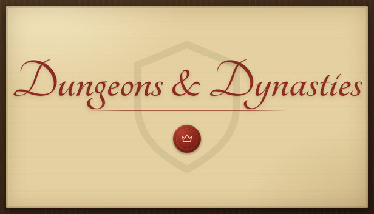

# Dungeons & Dynasties Save Game Editor

A save editor for Dungeons & Dynasties by Bretticus82. Built with Tauri v2, React 19, TypeScript, and Tailwind CSS.



---

## Features

### 1. Guild Overview and Treasury
- Treasury Gold: Direct input or preset increments (`+10k`, `+100k`, `+1M`).
- Realm Renown: Adjust guild prestige and tournament standing.
- Season Calendar: Change current day and year.
- Patron Confidence: Set patron favor up to 100%.
- Game Mode Toggles: Ironman Mode, Power Fantasy Mode, and Dungeonborn Origin.
- Guild Staff: Set skills up to 100 and wages to 0 for envoys, physicians, trainers, and scryers.

### 2. Roster Management
- Search and Filter: Filter by role (Tank, DPS, Healer) or search by name, kin, and class.
- Current Ability (CA) and Potential Ability (PA): Adjust 1 to 200 values with tier rankings (Novice, Established, Veteran, Elite, World Class).
- Condition and Morale: Track condition (0-100%) and morale (0-100%) with a single-click heal action.
- Character Sheet Modal:
  - 30 Combat Attributes (1 to 20): Physical, combat skills, mental, and tactical attributes.
  - 7 Hidden Attributes (1 to 20): Consistency, Big Game, Pressure, Injury Proneness, Loyalty, Adaptability, Ruthlessness.
  - Injury and Fatigue Cure: Remove stress, fatigue, and injuries.
  - Traits and Flaws: Add traits or remove negative flaws from the 84-trait database.

### 3. Cheats and Utilities
- Infinite Treasury: Set gold to `999,999,999`.
- Max Renown: Set renown to `1,000`.
- Restore Roster: Restore full condition and morale, and cure injuries for all heroes.
- Max Potential: Set Potential Ability to `200` for all roster heroes.
- Max Attributes: Set all 30 combat attributes to `20`.
- Max Hidden Attributes: Set Consistency, Loyalty, and Big Game traits to `20`.
- Revive Fallen: Move dead adventurers from the Graveyard back to the active roster with full health.

### 4. Stash and Armoury
- View equipment, weapons, and armor stored in the guild hall.
- Inspect affixes, rarities, tiers, and market values.
- One-click upgrade to Tier 5 with max quality multipliers.

### 5. Graveyard
- Inspect fallen adventurers.
- Revive selected delvers to the active roster.

---

## Running the Application

### Web Mode
Run in any modern browser using the HTML5 file API:
```bash
npm run dev
```
Open http://localhost:1420.

### Desktop Mode (Tauri)
Run as a desktop application with native file access:
```bash
npm run tauri:dev
```

### Build Executable
```bash
npm run tauri:build
```
The compiled binary outputs to `src-tauri/target/release/dndeditor.exe`.

---

## Save File Location and Backups

### Game Save Location
On Windows, Dungeons & Dynasties saves are stored in:
```text
%APPDATA%\io.itch.brettlittle.dungeons-and-dynasties\backups\
```

### Editor Backup System
The editor never writes `.bak` files into the game folder. Before saving any changes, the editor writes a timestamped copy of the original file into:
```text
%APPDATA%\dnd-saveeditor\editor-backups\
```

### Restoring an Edited Save
1. Save or export the `.json` file from the editor.
2. In Dungeons & Dynasties, open Settings, select Load a Ledger (or Restore).
3. Choose the edited file.
